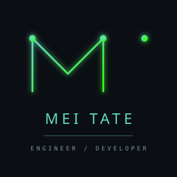

  

<!-- ==================== HERO ==================== -->

<table width="100%" bgcolor="#0B0F14">
<tr>
<td width="72%" valign="middle">

  CULTURE&nbsp;&nbsp; / &nbsp;&nbsp;CODE&nbsp;&nbsp; / &nbsp;&nbsp;INNOVATION

SOFTWARE ENGINEERING&nbsp;&nbsp; / &nbsp;&nbsp;MACHINE LEARNING&nbsp;&nbsp; / &nbsp;&nbsp;SYSTEMS
</td>
<td width="28%" align="center" valign="middle">

</td>
</tr>
</table>

<!-- ==================== ABOUT ==================== -->

<h2>
  
</h2>

  Software engineering student interested in building software across multiple layers of computing. I work with low-level systems in C/C++ and assembly, as well as full-stack web applications using the MERN stack.

  Currently pursuing a <b>Bachelor of Science in Computer Science</b> at
  <a href="https://oregonstate.edu/">Oregon State University</a>.

  Interested in software engineering, systems programming, data science, and learning new thing.

<!-- ==================== TECHNOLOGIES ==================== -->

<h2>
  
</h2>

<h3>01 / Programming Languages</h3>

  
  
  
  
  
  
  
  
  

<h3>02 / Full-Stack Development</h3>

  
  
  
  

<h3>03 / Systems & Low-Level Development</h3>

  
  
  
  

<h3>04 / Tools & Design</h3>

  
  
  
  

<!-- ==================== GITHUB STATS ==================== -->
<h2>
  
</h2>

  

<!-- ==================== CONTACT ==================== -->

<h2>
  
</h2>

  Interested in connecting or discussing software engineering, programming, or projects? Feel free to reach out.

  
  
  

<!-- ==================== CONTRIBUTIONS ==================== -->

<h2>
  
</h2>

  

<!-- ==================== FOOTER ==================== -->

